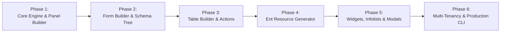

# Product Requirements Document (PRD): GoFilament
## High-Performance, Type-Safe Full-Stack Admin Panel & Application Toolkit for GoLaravel

---

## Executive Summary & Vision

**GoFilament** is a premier, batteries-included administrative toolkit and rapid application framework built natively on top of **GoLaravel** and **Ent ORM**. Inspired by Laravel's renowned Filament ecosystem (Panel Builder, Form Builder, Table Builder, Infolists, Actions, Widgets, and Notifications), GoFilament reimagines the developer experience for Go:

1. **Compiled Type-Safety & Zero Reflection**: Form schemas, table columns, filters, and actions are typed at compile-time with Go generics (`Resource[T]`), eliminating runtime reflection bottlenecks.
2. **Ent ORM Graph Integration**: Direct, first-class binding to Ent ORM schemas, predicates, edge traversals, eager-loading, soft deletes, and multi-tenancy privacy scopes.
3. **Reactive UI Without Node.js Overhead**: Powered by **Templ** server-side components, **Alpine.js**, and **HTMX / Server-Sent Events (SSE)**, delivering instantaneous single-page application (SPA) responsiveness, live reactive validation, and dynamic forms with a single compiled Go binary.
4. **Developer Ergonomics**: Declarative, fluent Go APIs that mirror the elegance of Laravel Filament while delivering 50x–100x higher throughput and sub-millisecond execution times.

---

## 1. Architectural Philosophy & Technology Stack

```
┌────────────────────────────────────────────────────────────────────────┐
│                              GoFilament                                │
│   ┌───────────────┬───────────────┬───────────────┬────────────────┐   │
│   │ Panel Builder │ Form Builder  │ Table Builder │ Infolist Engine│   │
│   ├───────────────┼───────────────┼───────────────┼────────────────┤   │
│   │ Actions/Modal │ Widget Studio │ Notifications │ Multi-Tenancy  │   │
│   └───────────────┴───────────────┴───────────────┴────────────────┘   │
├────────────────────────────────────────────────────────────────────────┤
│                    Reactive Presentation Layer                         │
│       Templ (SSR Go)  •  Alpine.js (Client State)  •  HTMX / SSE       │
│                  Tailwind CSS (Zero-Runtime Styling)                   │
├────────────────────────────────────────────────────────────────────────┤
│                      GoLaravel Framework Core                          │
│   Zero-Alloc Router • Ent ORM • Redis Queues • Cron • Storage • Auth   │
└────────────────────────────────────────────────────────────────────────┘
```

| Layer | Component | Implementation in GoFilament |
|---|---|---|
| **Server Runtime** | GoLaravel Engine | Context pooling, zero-allocation radix router, middleware pipeline, session/auth |
| **Data & ORM** | Ent ORM | Graph edges, type-safe queries, predicates, mutations, Atlas migrations |
| **View Engine** | Templ | Compile-time Go HTML component rendering with zero-reflection execution |
| **Reactivity** | Alpine.js + HTMX / SSE | Reactive form fields, live updates, modal dialogs, real-time table refreshing |
| **Design System** | Tailwind CSS & Icons | Filament-inspired clean admin design with dark mode, customizable color palettes |
| **Asset Pipeline** | Go Embed | Embedded CSS, JavaScript, and SVG assets compiled directly into the Go executable |

---

## 2. Panel Builder Architecture

The Panel Builder allows developers to configure multiple distinct administrative interfaces or application portals (e.g. `/admin`, `/app`, `/partner`, `/portal`) within a single GoLaravel application.

### 2.1 Panel Configuration & Provider
Panels are configured using a fluent builder and registered into the GoLaravel lifecycle:

```go
package panels

import (
    "github.com/golaravel/gofilament/pkg/filament"
    "github.com/golaravel/golaravel/pkg/auth"
)

func AdminPanel() *filament.Panel {
    return filament.NewPanel("admin").
        Path("/admin").
        BrandName("GoLaravel Cloud").
        BrandLogo("/assets/logo.svg").
        Favicon("/assets/favicon.ico").
        HomeURL("/admin").
        AuthGuard(auth.GuardSession).
        Login().
        Registration().
        PasswordReset().
        Profile().
        Colors(filament.ColorPalette{
            Primary: filament.ColorEmerald,
            Gray:    filament.ColorSlate,
        }).
        DarkMode(true).
        SidebarCollapsibleOnDesktop().
        MaxContentWidth(filament.WidthFull).
        NavigationGroups([]string{
            "Shop Management",
            "Customer Relations",
            "System & Settings",
        }).
        UserMenu(func(m *filament.UserMenu) {
            m.Item("My Profile", "/admin/profile").Icon("heroicon-user")
            m.Item("Billing", "/admin/billing").Icon("heroicon-credit-card")
        }).
        DatabaseNotifications(true).
        GlobalSearch(true).
        DiscoverResources("app/filament/resources").
        DiscoverPages("app/filament/pages").
        DiscoverWidgets("app/filament/widgets")
}
```

### 2.2 Global Search
- Searches across multiple registered resources simultaneously.
- Configurable per resource via `.GloballySearchable()` and `.GlobalSearchAttributes("name", "email", "sku")`.
- Live autocomplete dropdown powered by HTMX debounced search queries.

### 2.3 Topbar & Navigation System
- Collapsible responsive sidebar with grouped navigation items and badge counters (e.g., pending order count).
- Topbar navigation mode alternative (`.TopNavigation(true)`).
- Quick tenant switcher dropdown for multi-tenant organizations.
- User profile dropdown with theme switcher (Light / Dark / System).

---

## 3. Resource Engine (Ent ORM CRUD Integration)

Resources represent full-featured CRUD interfaces mapped to Ent models.

### 3.1 Resource Definition (`Resource[T]`)
Resources use Go generics for compile-time binding to the underlying Ent client and schema:

```go
package resources

import (
    "github.com/golaravel/gofilament/pkg/filament"
    "github.com/golaravel/gofilament/pkg/forms"
    "github.com/golaravel/gofilament/pkg/tables"
    "github.com/golaravel/golaravel/example/app/ent"
    "github.com/golaravel/golaravel/example/app/ent/user"
)

type UserResource struct {
    filament.BaseResource[*ent.User]
}

func NewUserResource() *UserResource {
    return &UserResource{
        BaseResource: filament.NewResource[*ent.User]("users").
            ModelName("User").
            PluralModelName("Users").
            NavigationGroup("System & Settings").
            NavigationIcon("heroicon-users").
            NavigationSort(1).
            NavigationBadge(func(ctx *filament.Context) string {
                count, _ := ctx.Ent().User.Query().Count(ctx)
                return fmt.Sprintf("%d", count)
            }),
    }
}

func (r *UserResource) Form(form *forms.Form) *forms.Form {
    return form.Schema(
        forms.Section("Account Information").
            Description("Personal identification and authentication credentials.").
            Columns(2).
            Schema(
                forms.TextInput("name").
                    Required().
                    MaxLength(255).
                    Placeholder("e.g. John Doe"),
                
                forms.TextInput("email").
                    Email().
                    Required().
                    Unique("users", "email").
                    Placeholder("user@example.com"),
                
                forms.TextInput("password").
                    Password().
                    RequiredOnCreate().
                    Dehydrated(func(state any) bool { return state != "" }).
                    Hash(),
                
                forms.Select("role").
                    Options(map[string]string{
                        "admin":  "Administrator",
                        "editor": "Editor",
                        "viewer": "Viewer",
                    }).
                    Default("viewer").
                    Required(),
            ),
    )
}

func (r *UserResource) Table(table *tables.Table[*ent.User]) *tables.Table[*ent.User] {
    return table.
        Columns(
            tables.TextColumn("id").Sortable(),
            tables.ImageColumn("avatar_url").Circular(),
            tables.TextColumn("name").Searchable().Sortable().Weight("bold"),
            tables.TextColumn("email").Searchable().Copyable().Icon("heroicon-envelope"),
            tables.BadgeColumn("role").Colors(map[string]string{
                "admin":  "danger",
                "editor": "warning",
                "viewer": "success",
            }),
            tables.TextColumn("created_at").DateTime().Sortable(),
        ).
        Filters(
            tables.SelectFilter("role").Options(map[string]string{
                "admin":  "Administrators",
                "editor": "Editors",
                "viewer": "Viewers",
            }),
            tables.TernaryFilter("email_verified_at").Label("Email Verified"),
        ).
        Actions(
            tables.ViewAction(),
            tables.EditAction(),
            tables.DeleteAction(),
        ).
        BulkActions(
            tables.DeleteBulkAction(),
            tables.ExportBulkAction().Formats("csv", "xlsx"),
        )
}
```

### 3.2 Resource Pages Lifecycle
Each resource generates standard CRUD sub-pages:
- **`ListRecords`**: Data table with filters, search, sorting, header actions, and bulk actions.
- **`CreateRecord`**: Record creation form with validation, before/after creation hooks, and redirects.
- **`EditRecord`**: Form pre-filled with record data, relationship management, and delete actions.
- **`ViewRecord`**: Read-only display schema (Infolist) with tabs and relation managers.

### 3.3 Relation Managers
Display related Ent models within the edit/view screen of a parent record:
- Example: `InvoicesRelationManager` embedded on the `CustomerResource` edit page.
- Full table operations (Add, Attach, Detach, Edit, Delete) executed in-place via modals without leaving the parent page.

---

## 4. Form Builder Engine

The Form Builder provides a declarative component tree for building data-entry forms with validation, conditional logic, and reactive state updates.

### 4.1 Schema Components

#### Input Fields
- `TextInput`: Text, email, password, tel, url, numeric with prefix/suffix text or icons.
- `Textarea`: Multi-line text with auto-resizing, rows configuration, and character count counters.
- `Select`: Static key-value options, dynamic database query options with search (`.Searchable()`), eager preload, and multi-select tags.
- `Checkbox` & `CheckboxList`: Single boolean or multiple selection checkboxes.
- `Toggle`: Clean toggle switch with inline label.
- `Radio`: Radio button groups with optional descriptions per option.
- `DatePicker`, `TimePicker`, `DateTimePicker`: Native or flatpickr-style date/time selection with min/max constraints and formatting.
- `FileUpload`: Local disk, S3, or MinIO storage with image cropping/resizing, drag-and-drop, max file size, mime-type validation, and AWS SigV4 presigned upload support.
- `RichEditor` / `MarkdownEditor`: Full WYSIWYG rich text editor with toolbar customization.
- `ColorPicker`: Hex/RGB color selector with preset palettes.
- `TagsInput`: Interactive tag creation and chips management.
- `KeyValue`: Key-value pair editor for JSON/hstore database fields.
- `CodeEditor`: Syntax-highlighted code editor for JSON, SQL, HTML, or Go snippets.
- `Hidden`: Hidden form values with default states.

#### Layout Components
- `Grid`: Multi-column responsive layout (`.Columns(12)`).
- `Section`: Visual panel with header, description, collapsible behavior (`.Collapsible()`), and icon.
- `Tabs` & `Tab`: Multi-tab views with badges and tab-switching state.
- `Fieldset`: Field grouping with native fieldset border and legend.
- `Split`: Horizontal split with customizable column width ratios.
- `Wizard` & `Wizard.Step`: Multi-step form with step navigation, validation per step, and progress bar.
- `Repeater`: Dynamic arrays of nested forms allowing users to add/remove/reorder sub-records.
- `Builder`: Flexible content block builder allowing dynamic page layouts (Hero blocks, Text blocks, Gallery blocks).

### 4.2 Reactivity & Live Form Logic (`.Live()`)
Form components support server-driven reactivity without custom JavaScript:

```go
forms.Select("country_id").
    Options(getCountryOptions).
    Live().
    AfterStateUpdated(func(state any, form *forms.Form) {
        // Dynamically update available cities when country changes
        form.GetField("city_id").SetOptions(getCitiesForCountry(state.(string)))
    }),

forms.TextInput("slug").
    Required().
    Disabled(),

forms.TextInput("title").
    Live(forms.Debounce(500*time.Millisecond)).
    AfterStateUpdated(func(title string, form *forms.Form) {
        form.GetField("slug").SetValue(slugify(title))
    })
```

- **Conditional Visibility**: `.Visible(func(get forms.Get) bool { return get("has_tax") == true })`.
- **Conditional Requirement**: `.Required(func(get forms.Get) bool { return get("status") == "published" })`.
- **Validation Rules**: Direct integration with GoLaravel's validation engine (`Required`, `Min`, `Max`, `Email`, `Regex`, `Custom`).

---

## 5. Table Builder Engine

The Table Builder renders responsive, high-performance data tables with server-side pagination, sorting, search, filtering, and bulk operations.

### 5.1 Column Types
- `TextColumn`: String, integer, currency formatting (`.Money("USD")`), date formatting (`.DateTime("2006-01-02")`), truncation (`.Limit(50)`), copyable to clipboard (`.Copyable()`), and tooltip support.
- `BadgeColumn`: Visual colored badge pill with dynamic color mappings (`.Colors()`).
- `IconColumn`: Boolean or state-mapped SVG icons (`heroicon-check-circle`, `heroicon-x-circle`).
- `ImageColumn`: Circular avatar or rounded thumbnail previews with lightbox zoom.
- `ColorColumn`: Color preview swatch with hex code.
- `ToggleColumn`: Inline live toggle switch that executes a background update mutation immediately.
- `SelectColumn`: Inline live dropdown selector that mutates the record without leaving the table.
- `TextInputColumn`: Inline editable text input with blur/enter save.

### 5.2 Filters
- `SelectFilter`: Dropdown filter for enum or relationship fields with multi-select support.
- `TernaryFilter`: Three-state boolean filter (All / Yes / No) ideal for soft-deletes (`TrashedFilter`) or verification flags.
- `Custom Filter with Schema`: Arbitrary form schema (e.g., date range picker from `start_date` to `end_date`) applying custom Ent query predicates:
  ```go
  tables.Filter("created_range").
      Form(
          forms.DatePicker("from"),
          forms.DatePicker("until"),
      ).
      Query(func(q *ent.OrderQuery, data map[string]any) *ent.OrderQuery {
          if from, ok := data["from"].(time.Time); ok {
              q = q.Where(order.CreatedAtGTE(from))
          }
          if until, ok := data["until"].(time.Time); ok {
              q = q.Where(order.CreatedAtLTE(until))
          }
          return q
      })
  ```

### 5.3 Actions & Modals in Tables
- **Inline Row Actions**: Clickable actions per row (View, Edit, Delete, Replicate, Custom actions).
- **Header Actions**: Top-of-table actions (Create new record, Import data, Export to CSV/Excel).
- **Bulk Actions**: Checkbox-selected multi-record operations (Bulk Delete, Bulk Status Update, Bulk Export).
- **Confirmation Modals**: Built-in modal alerts before destructive actions (`.RequiresConfirmation()`).

---

## 6. Infolists Builder (Read-Only Presenter)

The Infolists Builder renders read-only detail view pages for resources, replacing static view templates with declarative schemas.

```go
func (r *OrderResource) Infolist(infolist *infolists.Infolist) *infolists.Infolist {
    return infolist.Schema(
        infolists.Section("Order Details").
            Columns(3).
            Schema(
                infolists.TextEntry("order_number").Weight("bold").Copyable(),
                infolists.TextEntry("customer.name").Label("Customer"),
                infolists.BadgeEntry("status").Colors(orderStatusColors),
                infolists.TextEntry("total_amount").Money("USD"),
                infolists.TextEntry("created_at").DateTime(),
            ),
        infolists.Section("Line Items").
            Schema(
                infolists.RepeatableEntry("items").
                    Columns(4).
                    Schema(
                        infolists.TextEntry("product.name").Label("Product"),
                        infolists.TextEntry("unit_price").Money("USD"),
                        infolists.TextEntry("quantity"),
                        infolists.TextEntry("subtotal").Money("USD"),
                    ),
            ),
    )
}
```

---

## 7. Actions, Modals & Slide-Overs Engine

A unified Action engine used across all of GoFilament (Pages, Tables, Forms, Infolists).

### 7.1 Action Capabilities
- **Modal Forms**: An action can open a modal popup containing a full form schema to collect input before execution:
  ```go
  tables.Action("refund").
      Label("Refund Order").
      Icon("heroicon-arrow-uturn-left").
      Color("danger").
      RequiresConfirmation().
      Form(
          forms.TextInput("amount").Required().Numeric(),
          forms.Textarea("reason").Required(),
      ).
      Action(func(ctx *filament.ActionContext, record *ent.Order, data map[string]any) error {
          amount := data["amount"].(float64)
          reason := data["reason"].(string)
          return paymentGateway.Refund(record.PaymentID, amount, reason)
      })
  ```
- **Slide-Over Drawers**: Open complex forms or views in a smooth right-hand drawer (`.SlideOver()`).
- **Authorization**: Automatic visibility checks using GoLaravel policies (`.Authorize(func(ctx) bool)`).
- **Notifications on Complete**: Automatically triggers toast or database notifications upon success or error.

---

## 8. Dashboard, KPI Widgets & Analytics Studio

Dashboards provide executive metric overviews using a flexible widget grid.

### 8.1 Widget Types
1. **`StatsOverviewWidget`**:
   - KPI metrics cards displaying big numbers, contextual descriptions, positive/negative percentage trends, and mini sparkline graphs.
   ```go
   type DashboardOverview struct {
       widgets.BaseStatsOverviewWidget
   }

   func (w *DashboardOverview) Stats(ctx *filament.Context) []widgets.Stat {
       return []widgets.Stat{
           widgets.NewStat("Total Revenue", "$128,430").
               Description("32% increase this month").
               DescriptionIcon("heroicon-arrow-trending-up").
               Color("success").
               Chart([]int{15, 22, 35, 45, 60, 78, 128}),

           widgets.NewStat("Active Subscriptions", "1,420").
               Description("3% decrease").
               DescriptionIcon("heroicon-arrow-trending-down").
               Color("danger").
               Chart([]int{1500, 1480, 1460, 1450, 1430, 1420}),
       }
   }
   ```
2. **`ChartWidget`**:
   - Interactive line, bar, pie, doughnut, and radar charts.
   - Built on Chart.js with responsive resizing and dark-mode themes.
   - Built-in period filter dropdown (e.g. Today, Last 7 Days, Last 30 Days, This Year).
3. **`TableWidget`**:
   - Embedded mini data tables for "Recent Orders", "Top Customers", or "Latest Activity".
4. **`CustomWidget`**:
   - Custom Templ component rendering arbitrary HTML widgets.

### 8.2 Real-time Polling & Live Streaming
- Widgets can declare polling intervals: `.PollingInterval("15s")`.
- Real-time updates delivered over Server-Sent Events (SSE) or WebSockets via GoLaravel's `pkg/broadcast`.

---

## 9. Multi-Tenancy & Access Control (Shield & Policies)

### 9.1 Tenant Isolation
- Out-of-the-box tenant scoping powered by GoLaravel's `privacy.TenantMixin`.
- Multi-tenancy options:
  - **Subdomain-based**: `tenant1.app.domain.com/admin`
  - **Path-based**: `domain.com/admin/tenants/{tenant}`
- Tenant switcher dropdown in the navigation bar.
- Automatic Ent query predicate injection: all resource queries, table queries, and form mutations are scoped to the active tenant.

### 9.2 Authorization & Role-Based Access Control
- Integrated with GoLaravel's `pkg/auth` Gate and Policy system.
- Per-resource policy mapping:
  ```go
  // In app/policies/user_policy.go
  type UserPolicy struct{}

  func (UserPolicy) ViewAny(u *ent.User) bool   { return u.Role == "admin" }
  func (UserPolicy) Create(u *ent.User) bool    { return u.Role == "admin" }
  func (UserPolicy) Update(u *ent.User, target *ent.User) bool { return u.Role == "admin" || u.ID == target.ID }
  func (UserPolicy) Delete(u *ent.User, target *ent.User) bool { return u.Role == "admin" && u.ID != target.ID }
  ```
- Field-level and column-level permission checks (`.Visible(func(ctx) bool)`).

---

## 10. Real-Time Notifications Engine

- **Toast Notifications**: Interactive slide-in alerts (Success, Info, Warning, Danger) with action buttons and dismiss timers.
- **Database Notifications Bell**: Topbar notification bell icon with unread count badge.
- **Notification Drawer**: Slide-out panel listing past notifications with "Mark as Read" and "Clear All".
- **Real-Time Push**: Instant delivery without page reloads using GoLaravel's WebSocket / SSE broadcast engine (`pkg/broadcast`).

---

## 11. Reactive Frontend Architecture (Templ + Alpine.js + HTMX)

GoFilament achieves dynamic single-page application (SPA) responsiveness **without requiring Node.js, Webpack, Vite, or npm in production**:

```
┌────────────────────────────────────────────────────────┐
│                      Client Browser                    │
│   Alpine.js (Stores, Modals, Dropdowns, Datepickers)   │
│   HTMX (Targeted DOM Morphing, Form Submissions, Poll) │
└──────────────────────────┬─────────────────────────────┘
                           │ HTTP / SSE / WebSocket
┌──────────────────────────▼─────────────────────────────┐
│                   GoFilament Server Engine             │
│   Templ (Type-Safe SSR HTML & Micro-Component Diffing) │
│   Context Pool & Zero-Allocation Radix Router          │
└────────────────────────────────────────────────────────┘
```

- **SPA Mode**: Smooth page transitions using client-side prefetching and DOM replacement.
- **Micro-Component Swapping**: Form updates (`.Live()`), table sorting, and pagination swap only the targeted DOM node via HTMX, resulting in instant < 5ms response times.
- **Single Static Binary**: All CSS, JavaScript libraries (Alpine.js, HTMX, Chart.js), and Heroicons SVG files are embedded via Go's `//go:embed`.

---

## 12. Artisan CLI Tooling (`artisan make:filament-*`)

Full suite of code generator commands integrated directly into the GoLaravel Artisan CLI:

| Command | Output Path | Description |
|---|---|---|
| `artisan make:filament-panel <Name>` | `app/filament/panels/<name>_panel.go` | Creates a new panel configuration |
| `artisan make:filament-resource <Name> [--generate] [--view]` | `app/filament/resources/<name>_resource.go` | Generates a full Ent CRUD resource with Form and Table schemas |
| `artisan make:filament-page <Name> [--resource=]` | `app/filament/pages/<name>.go` | Creates a custom panel page or resource sub-page |
| `artisan make:filament-widget <Name> [--stats\|--chart\|--table]` | `app/filament/widgets/<name>_widget.go` | Generates a KPI stats, chart, or mini-table dashboard widget |
| `artisan make:filament-relation <Resource> <Relation>` | `app/filament/resources/<resource>/relations/` | Generates an interactive relationship manager |
| `artisan make:filament-theme <Name>` | `resources/css/filament/<name>.css` | Scaffolds a custom Tailwind theme and palette |

---

## 13. Directory Structure & Conventions

A standard GoLaravel application with GoFilament:

```
my-app/
├── app/
│   ├── filament/
│   │   ├── panels/
│   │   │   ├── admin_panel.go          # Admin panel configuration
│   │   │   └── app_panel.go            # Customer application portal
│   │   ├── resources/
│   │   │   ├── user_resource.go        # User CRUD resource
│   │   │   ├── order_resource.go       # Order CRUD resource
│   │   │   └── order_resource/
│   │   │       ├── pages/
│   │   │       │   ├── list_orders.go
│   │   │       │   ├── create_order.go
│   │   │       │   └── view_order.go
│   │   │       └── relations/
│   │   │           └── items_relation_manager.go
│   │   ├── pages/
│   │   │   ├── dashboard.go            # Custom Dashboard page
│   │   │   └── system_settings.go      # Custom Settings page
│   │   └── widgets/
│   │       ├── revenue_stats_widget.go
│   │       └── orders_chart_widget.go
│   ├── schema/                         # Ent ORM database schemas
│   └── policies/                       # Resource authorization policies
├── pkg/
│   └── gofilament/                     # Core GoFilament framework package
│       ├── filament.go                 # Top-level API facade
│       ├── panel/                      # Panel builder & routing
│       ├── forms/                      # Form builder & schema components
│       ├── tables/                     # Table builder, columns & filters
│       ├── infolists/                  # Infolist builder & entries
│       ├── actions/                    # Actions, modals & slide-overs
│       ├── widgets/                    # Dashboard widgets & charts
│       ├── notifications/              # Toast & database notifications
│       └── views/                      # Templ component templates
└── go.mod
```

---

## 14. Non-Functional Requirements & Performance Targets

| Metric | Target | Measurement Benchmark |
|---|---|---|
| **Table List Page Throughput** | > 85,000 req/sec | 1,000 records with pagination, search & filters (wrk / hey) |
| **Form Rendering Latency** | < 0.8 ms | Complex 20-field form with nested sections and tabs |
| **Memory per Request** | < 45 KB | Zero-allocation radix router and recyclable context pooling |
| **Executable Size** | < 35 MB | Pure self-contained binary including all embedded frontend assets |
| **Build / Compile Time** | < 3 seconds | Pure Go compilation with pre-generated Templ views |
| **Browser Network Footprint** | < 120 KB gzip | Lightweight Alpine.js + HTMX vs React/Vue 500KB+ bundles |

---

## 15. Phased Implementation Roadmap



### Phase 1: Core Engine & Panel Builder Foundation
- Define `filament.Panel`, panel registry, router mounting on GoLaravel.
- Global navigation, sidebar, topbar, theme engine (dark/light mode), and asset embedder.
- Authentication screens (Login, Password Reset, Profile).

### Phase 2: Form Builder & Schema Component Library
- Generic `Form` engine with 15+ input field components.
- Layout system (`Grid`, `Section`, `Tabs`, `Fieldset`, `Wizard`, `Repeater`).
- Reactive `.Live()` state updates via HTMX and validation error bag integration.

### Phase 3: Table Builder Engine & Filters
- `Table[T]` engine with `TextColumn`, `BadgeColumn`, `IconColumn`, `ImageColumn`, `ToggleColumn`.
- Server-side sorting, global search, and column-specific search.
- Filter types: `SelectFilter`, `TernaryFilter`, and custom Form filters with Ent predicates.
- Row actions, bulk actions, and pagination controls.

### Phase 4: Ent Resource Generator & CRUD Controller
- `Resource[T]` generic abstraction binding directly to Ent ORM clients.
- Scaffolding of `ListRecords`, `CreateRecord`, `EditRecord`, `ViewRecord`.
- Artisan generator: `artisan make:filament-resource <Model>`.

### Phase 5: Infolists, Action Modals, Slide-Overs & Dashboard Widgets
- Infolist schema builder for read-only record displays.
- Modal dialogs and Slide-Over drawers for actions with embedded forms.
- `StatsOverviewWidget` with sparklines and `ChartWidget` (Chart.js integration).
- Real-time notification drawer and bell icon.

### Phase 6: Multi-Tenancy, Policies & Production Hardening
- Tenant switcher and automatic `privacy.TenantMixin` query scoping.
- Spatie/Shield-style Role-Based Access Control via GoLaravel policies.
- End-to-end integration test suite and high-concurrency benchmarks.
